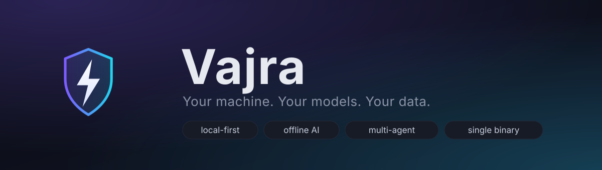
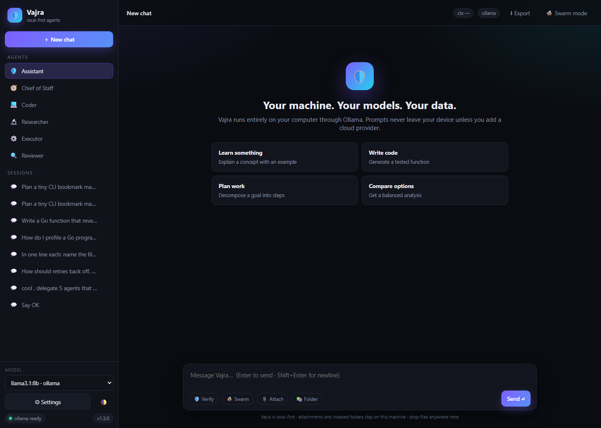
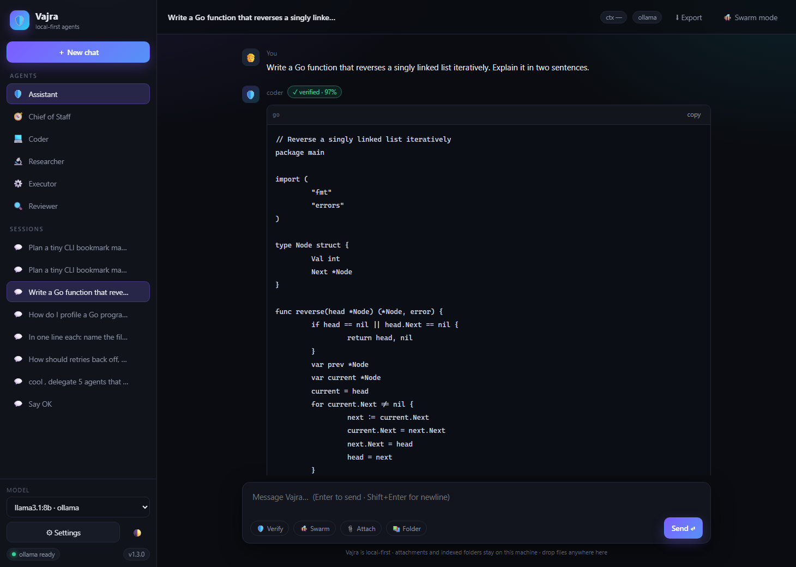
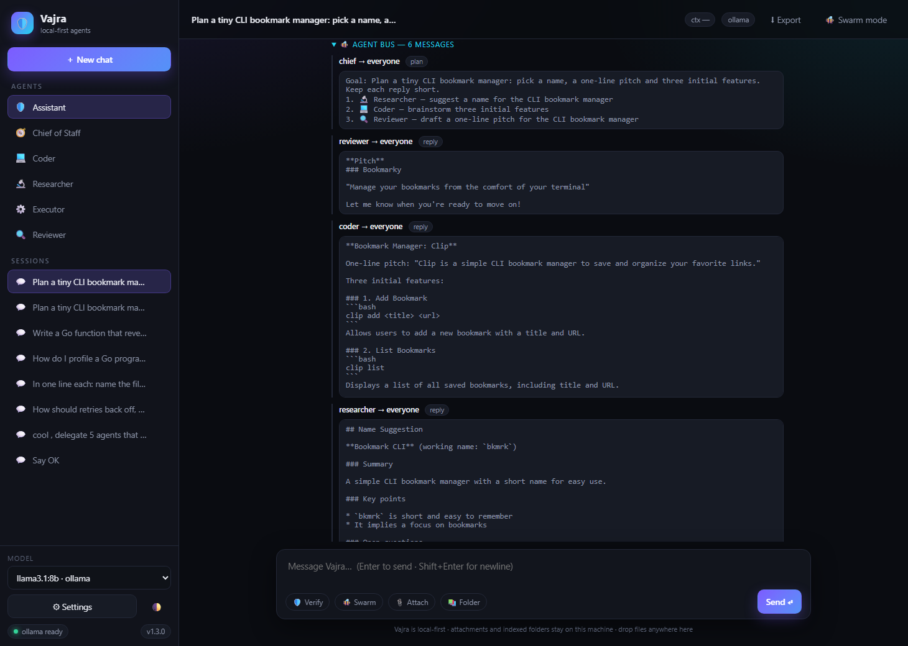
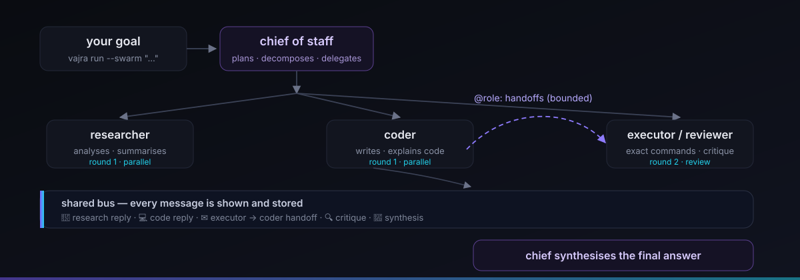
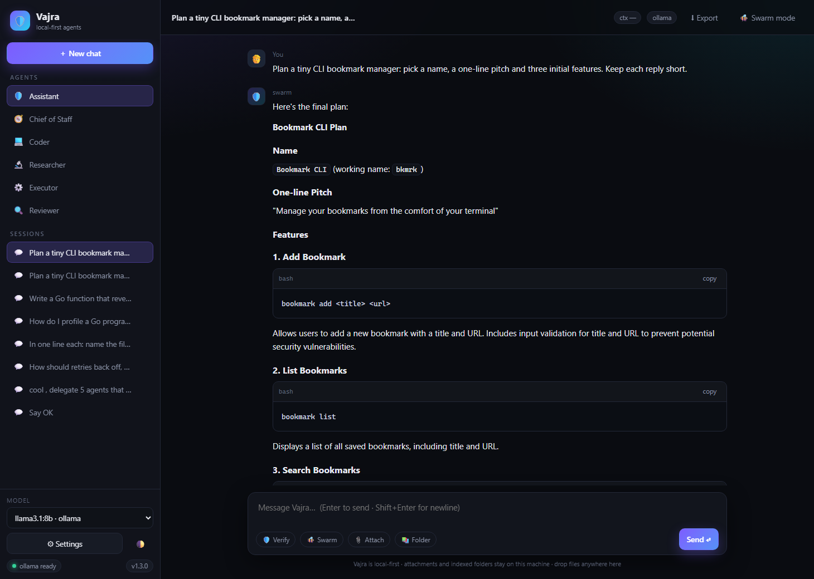
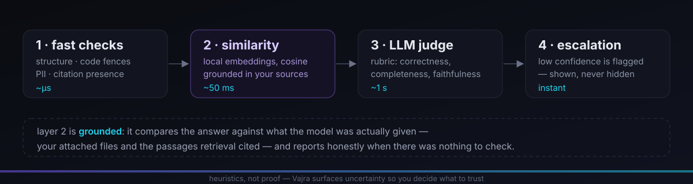
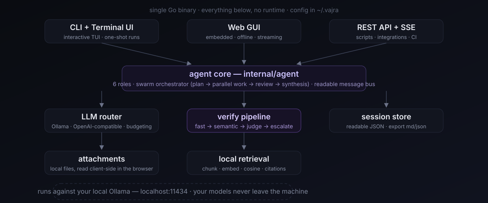

<div align="center">



# 🛡️ Vajra

### The local-first AI agent workspace — your machine, your models, your data.

One ~9 MB Go binary that gives you a **terminal UI**, an **offline web GUI** and a
**REST API** on top of local models through [Ollama](https://ollama.com) — with
**multi-agent swarm orchestration**, **your own files as context** and a
**4-layer anti-hallucination pipeline**.

**No API key. No telemetry. No cloud. Works fully offline.**

[](https://github.com/Ritiksuman07/Vajra/stargazers)
[](https://github.com/Ritiksuman07/Vajra/forks)
[](https://github.com/Ritiksuman07/Vajra/releases)
[](https://github.com/Ritiksuman07/Vajra/releases)
[](https://github.com/Ritiksuman07/Vajra/actions/workflows/ci.yml)
[](LICENSE)
[](https://go.dev)
[](https://ollama.com)
[](https://github.com/Ritiksuman07/Vajra/issues)
[](https://github.com/Ritiksuman07/Vajra/discussions)

**[Quick start](#-quick-start)** · **[Screenshots](#-see-it)** · **[Agent swarm](#-the-agent-swarm)** · **[Your files](#-your-files-locally)** · **[Verification](#-anti-hallucination)** · **[Docs](#-documentation)** · **[FAQ](docs/FAQ.md)**

</div>

---

Vajra is a **self-hosted AI agent workspace** for people who don't want their
prompts — or their files — leaving their computer. It runs a local model for
you, wires five specialist agents and a review pipeline around it, and talks to
you through a terminal, a browser or plain HTTP. Nothing is a service: the
index is JSON, the sessions are JSON, the UI is embedded in the binary.

## 📸 See it

Every image below is **the real application**, captured on a real Ollama
backend (`llama3.1:8b`).

<p align="center">
  
  <br/><sub><b>The offline web GUI</b> — <code>vajra web</code>, no CDN and no build step; everything ships inside the binary.</sub>
</p>

<p align="center">
  
  <br/><sub><b>Verified answers.</b> Every reply can be graded by the 4-layer pipeline (here: <code>✓ verified · 97%</code>).</sub>
</p>

<p align="center">
  
  <br/><sub><b>The agent bus</b> — you can read every message the agents exchanged, live or re-opened later.</sub>
</p>

> The **terminal UI** ships in the same binary: `Ctrl+T` swaps to swarm mode,
> `Ctrl+B` opens the agent bus, `Ctrl+V` runs verification, `Ctrl+E` exports the
> session. Same agents, same pipeline, no browser.

## ✨ What's in the box

- 🧩 **One static binary (~9 MB).** No Python, no Node, no Docker, no `pip install`.
  Windows/macOS/Linux, amd64 + arm64.
- 🐝 **A swarm, not a chatbot.** A Chief of Staff plans your goal and **3–4
  specialists work in parallel** — then review each other and hand work off
  with `@role:` requests on a bus you can read.
- 🛡️ **Four verification layers.** Fast checks → embedding similarity →
  LLM-as-a-judge → human escalation. Grounded in the sources the model was
  actually given, and honest when there's nothing to check.
- 📎 **Your files, verifiably local.** Attach files (📎, drag-and-drop, `@path`,
  `--file`) or index a whole folder and ask questions with `file:line`
  citations — no vector database, no upload, no account.
- 🧮 **Context that budgets itself.** Long chats are trimmed to the model's
  window; the system prompt and your latest question always survive.
- 🖥️ **Three interfaces, one core.** TUI (`vajra`), web GUI (`vajra web`),
  REST + SSE (`vajra serve`) — or one-shot `vajra run`.
- ✍️ **Export anything.** Any session as Markdown or JSON, including the
  attachments used, the cited sources and the full swarm transcript.
- 🔌 **Local-first ≠ local-only.** Add an OpenAI/Anthropic/OpenRouter/Groq key
  only if *you* decide to — routing is automatic (`claude-*` → Anthropic,
  `gpt-*` → OpenAI, everything else → local Ollama).

## 🚀 Quick start

**1. Get a local model** ([Ollama](https://ollama.com/download) — one-time)

```bash
ollama pull llama3.1:8b
```

**2. Install Vajra**

| Platform | Install |
|----------|---------|
| **Windows** | Download the `VajraSetup-<version>-win-x64.exe` installer from [Releases](https://github.com/Ritiksuman07/Vajra/releases) |
| **Linux / macOS** | `curl -fsSL https://raw.githubusercontent.com/Ritiksuman07/Vajra/main/scripts/install.sh \| bash` |
| **Any (Go)** | `go install github.com/Ritiksuman07/Vajra@latest` |
| **From source** | `git clone https://github.com/Ritiksuman07/Vajra && cd Vajra && make build` |

**3. Run**

```bash
vajra          # interactive terminal UI
vajra web      # web GUI  →  http://127.0.0.1:4096
vajra doctor   # check your setup end-to-end
```

Every release ships with `.sha256` checksums for each artifact — verify what you
download with `sha256sum -c`.

## 🖥️ CLI in 60 seconds

```bash
vajra run "explain goroutines"                  # one-shot, streams to stdout
vajra run --agent coder "review this" < file.go # pick a persona, pipe input
vajra run --file notes.md "summarise this"      # attach local files
vajra run --rag ~/notes "summarise my retries"  # answer from an indexed folder
vajra run --swarm "design a CLI bookmark tool"  # multi-agent swarm
vajra index ~/notes                             # chunk + embed a folder
vajra rag ~/notes "what did I decide about retries?"
vajra verify "Paris is the capital of France."  # run the pipeline on any claim
vajra export [--format md|json] [--out path]    # export a session
vajra serve --port 8080                         # REST API + SSE
```

## 🐝 The agent swarm

<p align="center">
  
</p>

| Agent | Role | Suggested model |
|-------|------|-----------------|
| 🧭 **Chief of Staff** | Plans, decomposes, delegates, synthesises | `llama3.1:70b` |
| 💻 **Coder** | Writes and explains code | `qwen2.5-coder:7b` |
| 🔬 **Researcher** | Analyses and summarises | `llama3.1:8b` |
| ⚙️ **Executor** | Produces exact commands | `phi3.5` |
| 🔍 **Reviewer** | Reviews for correctness & security | `llama3.1:8b` |
| 🛡️ **Assistant** | Everyday general help | `llama3.1:8b` |

The Chief plans the goal, the specialists make their **round-1 parallel** reply,
the Reviewer posts a critique, and agents can ask each other for follow-ups
with `@role: request` — parsed, dispatched and answered on the bus. Cost is
bounded by design: one parallel round, one critique, at most three handoffs,
one synthesis. **The roster is never a lone agent** — if a small model plans
only one task, Vajra tops up from a default rotation so at least three distinct
agents always run.

You can read the whole exchange while it happens (TUI `Ctrl+B`, web 🐝 panel)
or after the fact — the transcript is stored with the session and exported to
Markdown or JSON.

<p align="center">
  
  <br/><sub><b>A real swarm run</b> — goal in, synthesised plan out; the full agent transcript is stored with the session.</sub>
</p>

## 📂 Your files, locally

**Attach files** — 📎 or drag-and-drop in the web UI (read in your browser, so
the server never opens a path on your behalf), `/attach` or `@path` in the TUI,
repeatable `--file` on the CLI. Binary and oversized files are skipped *and
reported* — nothing disappears silently.

```bash
vajra run --file README.md --file internal/rag/rag.go "what does rag.go do?"
```

**Ask a whole folder** — index once, then search by meaning:

```bash
ollama pull nomic-embed-text     # a small embedding model
vajra index ~/notes
vajra rag ~/notes "what did I decide about retries?"
vajra run --rag ~/notes "summarise my retry decisions"
```

Answers cite what they used, as `file:line` with a similarity score:

```text
[1] retries.md:1 (similarity 0.81)
# Retry policy
The retry policy uses exponential backoff with full jitter.
```

There is **no vector database and no service**: chunks are embedded by your
local model, stored as JSON in `~/.vajra/index`, and ranked with cosine
similarity. Build output, dependency folders and dot-directories are skipped;
file counts, chunk sizes and total index size are all bounded.

**Long chats trim themselves.** The conversation is budgeted against the
model's context window (default `8192` tokens, `VAJRA_MAX_CONTEXT` to change).
Older turns drop from the front; the system prompt and your latest question
always survive. Both UIs show the level (`ctx 2.1k/8.2k`) and say so when
something was trimmed.

## ✅ Anti-hallucination

<p align="center">
  
</p>

| Layer | What it does | Cost |
|-------|--------------|------|
| **1 · Fast checks** | Structure, unbalanced code fences, PII, citation presence | ~µs |
| **2 · Semantic similarity** | Embeds the answer + your sources, requires cosine ≥ 0.75 | ~50 ms |
| **3 · LLM-as-a-judge** | Rubric: correctness, completeness, faithfulness, coherence | ~1 s |
| **4 · Human escalation** | Low-confidence answers are **flagged**, never hidden | instant |

```bash
vajra run --verify "what is the capital of Australia?"
vajra verify "Paris is the capital of France."
```

Verification is **grounded**: your attached files and the passages retrieval
cited are handed to layer 2 and the judge, so "verified" means *the answer
resembles its sources* — not that it's a universal truth. When there was
nothing to compare against, layer 2 reports that it was skipped rather than
pretending to have checked.

> **Straight truth:** these are heuristics, not proof. Vajra is upfront about
> it — the pipeline surfaces uncertainty visibly so *you* decide what to trust.
> Docs: [how verification works](docs/ARCHITECTURE.md).

## 🔐 Privacy in four lines

- Prompts go to `localhost:11434`. There is **no telemetry, no account, no
  crash reporting** — the binary makes no outbound calls unless you configure a
  provider.
- The web UI and API bind to `127.0.0.1` by default; `--host` is an explicit
  opt-in that prints a warning.
- Attachments in the browser are read by the *browser* and sent as text — the
  server never touches an arbitrary path on your behalf.
- Sessions, indexes and exports stay in `~/.vajra`; `vajra export` writes them
  wherever you point it. Report vulnerabilities via
  [SECURITY.md](SECURITY.md).

## ☁️ Optional cloud (as in, optional)

```bash
vajra connect openai     sk-...
vajra connect anthropic  sk-ant-...
vajra connect openrouter sk-or-...
vajra connect groq       gsk_...
vajra connect lmstudio           # local, OpenAI-compatible
```

Routing is automatic: `claude-*` → Anthropic, `gpt-*` → OpenAI,
`vendor/model` → OpenRouter, **everything else → local Ollama**.

## 📊 How Vajra compares

| | **Vajra** | Cloud chat apps | Other local agent frameworks |
|---|:---:|:---:|:---:|
| Works without an API key | ✅ | ❌ | ✅ |
| Runs fully offline | ✅ | ❌ | ✅ |
| Single binary, no runtime | ✅ | ✅ | ❌ |
| Terminal UI | ✅ | ❌ | ⚠️ varies |
| Built-in offline web GUI | ✅ | ✅* | ❌ |
| Multi-agent swarm mode | ✅ | ❌ | ⚠️ varies |
| Readable agent-to-agent messages | ✅ | ❌ | ❌ |
| Verification pipeline | ✅ | ❌ | ❌ |
| Session export (md/json) | ✅ | ⚠️ varies | ⚠️ varies |
| Zero telemetry | ✅ | ❌ | ⚠️ varies |

\* most "local" forks still rely on CDN assets or a build step.

## 🏛️ Architecture

<p align="center">
  
</p>

Layered into focused packages under `internal/` — the full tour is
[docs/ARCHITECTURE.md](docs/ARCHITECTURE.md):

| Package | Role |
|---------|------|
| `internal/config` | Settings, `VAJRA_*` env precedence |
| `internal/llm` | Router (Ollama, OpenAI-compatible), token budgeting |
| `internal/agent` | Six roles, swarm orchestrator, message bus |
| `internal/verify` | The 4-layer anti-hallucination pipeline |
| `internal/attach` / `internal/rag` / `internal/session` | Files · local retrieval · sessions + export |
| `internal/tui` / `internal/server` | Terminal UI · REST + SSE + embedded web app |

## ⚙️ Configuration

Config lives at `~/.vajra/config.json`; sessions in `~/.vajra/sessions/`,
retrieval indexes in `~/.vajra/index/`, exports in `~/.vajra/exports/`.

```bash
vajra config --set model=llama3.1:8b
vajra config --set verify=true
vajra config --set ollama_host=http://localhost:11434
```

| Env var | Effect |
|---------|--------|
| `VAJRA_MODEL`, `VAJRA_AGENT`, `VAJRA_PORT`, `VAJRA_VERIFY` | Defaults |
| `VAJRA_MAX_CONTEXT` | Context-window budget in tokens (default `8192`) |
| `VAJRA_CONFIG_DIR` | Where config, sessions and indexes live |
| `OLLAMA_HOST` / `VAJRA_OLLAMA_HOST` | Ollama endpoint |

## 📚 Documentation

| | |
|---|---|
| [Setup & troubleshooting](docs/SETUP.md) | Install Ollama + Vajra, fix common issues |
| [CLI reference](docs/CLI.md) | Every command, flag and keybinding |
| [HTTP API](docs/API.md) | REST + SSE endpoints with examples |
| [Agents](docs/agents.md) | Roles, swarm mode, bus, routing |
| [Architecture](docs/ARCHITECTURE.md) | How the pieces fit |
| [FAQ](docs/FAQ.md) | Privacy, specs, common questions |
| [Roadmap](docs/TODO.md) | What shipped, what's next |
| [Packaging](packaging/PACKAGING-README.md) | Installers & the release process |

## 🤝 Community

Contributions are welcome — see [CONTRIBUTING.md](CONTRIBUTING.md)
(`make test` runs `go test ./... -race`; CI runs vet, lint and the race
detector on all three OSes and blocks on all of them). Good first tasks:
[`good first issue`](https://github.com/Ritiksuman07/Vajra/labels/good%20first%20issue),
[`help wanted`](https://github.com/Ritiksuman07/Vajra/labels/help%20wanted).
Ask questions in
[Discussions](https://github.com/Ritiksuman07/Vajra/discussions).

Coming next: incremental re-indexing, tool calling behind an allow-list, and
`winget`/Homebrew packages — see
[docs/TODO.md](docs/TODO.md).

## 📄 License

MIT © [Ritik Suman](https://github.com/Ritiksuman07) and
[contributors](https://github.com/Ritiksuman07/Vajra/graphs/contributors). See
[LICENSE](LICENSE). Cite Vajra via
[CITATION.cff](CITATION.cff).

## ⭐ Star history

[](https://star-history.com/#Ritiksuman07/Vajra&Date)

<div align="center">

**If Vajra is useful to you, a ⭐ helps other people find local-first AI.**

[⬇ Download](https://github.com/Ritiksuman07/Vajra/releases) ·
[🐛 Report a bug](https://github.com/Ritiksuman07/Vajra/issues/new?template=bug_report.md) ·
[💡 Request a feature](https://github.com/Ritiksuman07/Vajra/issues/new?template=feature_request.md) ·
[💬 Discuss](https://github.com/Ritiksuman07/Vajra/discussions)

<sub>local-first ai agent · offline ai · local llm · self-hosted · open source · ollama · golang · multi-agent · autonomous agents · anti-hallucination · privacy · privacy-first · terminal ui · web gui · rest api · zero telemetry · no api key · file rag · session export · model context budgeting</sub>

</div>
